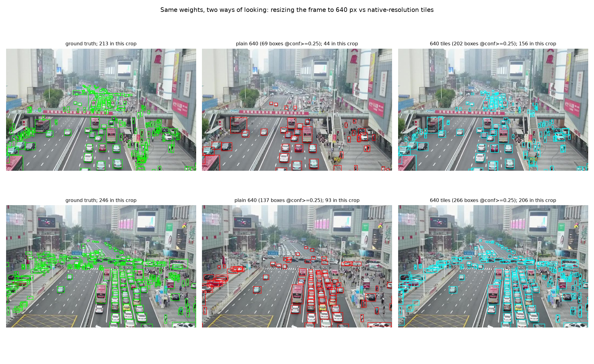
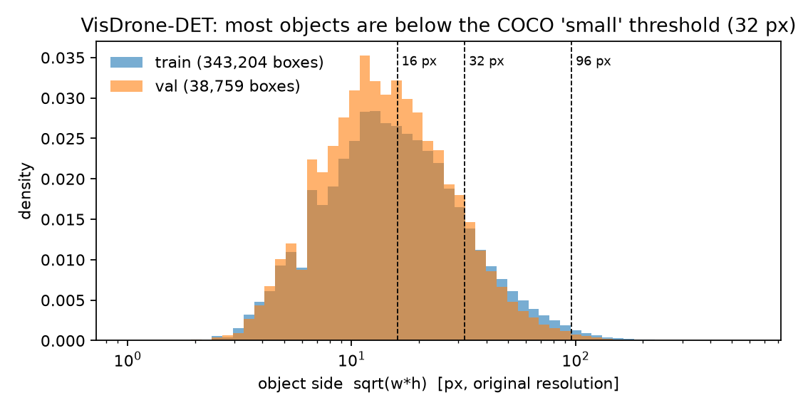
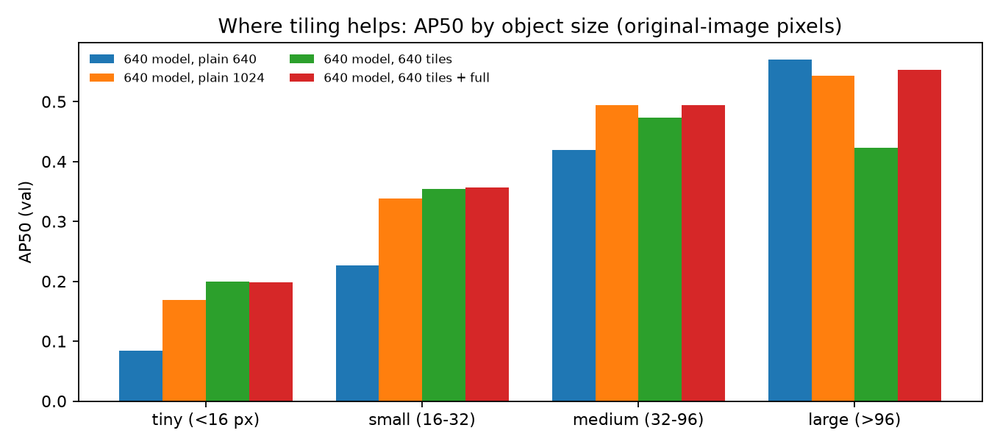
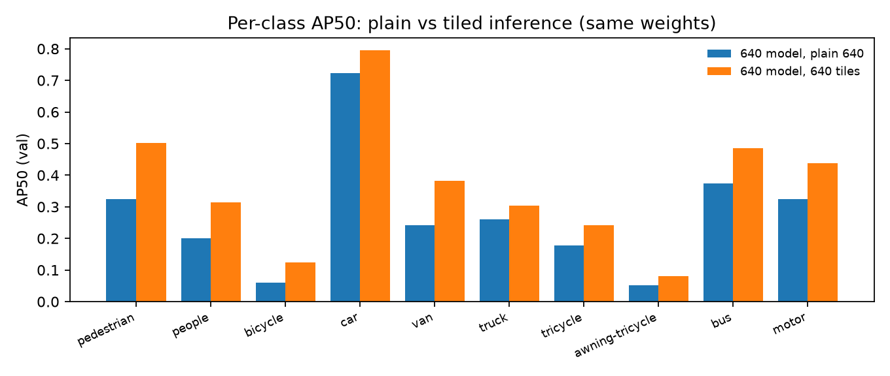
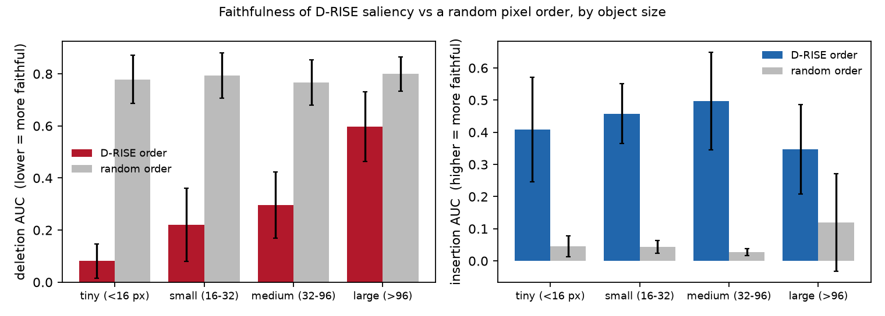
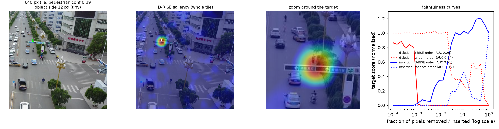

# Small-object detection on VisDrone: scale-aware evaluation, tiled inference and black-box explanations

[](https://github.com/maryamtavasoli98/small-object-detection-visdrone/actions/workflows/ci.yml)

Aerial images in the VisDrone benchmark are full of objects that are a few pixels wide. A detector that scores well on
"mAP" can still miss most pedestrians at 50 m altitude, because they vanish when a 1360×765 frame
is resized to 640 px. This repository asks three concrete questions on [VisDrone2019-DET](http://aiskyeye.com/):

1. **Where exactly does a modern one-stage detector (YOLO11n) fail?** Not one number, but AP per
   object-size bin (tiny < 16 px, small 16–32 px, medium 32–96 px, large > 96 px) with the dataset's
   ignored-region protocol.
2. **How much of the small-object gap can tiled (sliced) inference close, at what cost?** Overlapping
   native-resolution tiles merged with per-class NMS (own implementation, unit-tested), compared with
   simply feeding a larger input.
3. **Can we explain individual detections of tiny objects, and are the explanations faithful?**
   D-RISE black-box saliency, checked with deletion/insertion curves against a random baseline.

**Short answer so far.** With the standard 640 px resize, YOLO11n reaches AP50 0.274 on the validation set, but only
0.085 on objects under 16 px (vs 0.570 on objects over 96 px). Tiled inference raises tiny-object AP50 to 0.199 and
overall AP50 to 0.375 (tiles + full frame), at about 5× the inference time. A cheaper baseline is surprisingly strong:
just feeding the same model a 1024 px frame at test time gives AP50 0.365 at no extra cost, so most of the tiling gain
comes from resolution, and tiling's advantage is concentrated in the tiny and small bins. D-RISE saliency
maps are faithful to the detector even for 13 px objects (deletion AUC 0.08 vs 0.78 for a random pixel order),
but the evaluation protocol has to be adapted to tiny targets to show it.



## Data

VisDrone2019-DET (Zhu et al., 2021 [1]): 6,471 training and 548 validation images from drones over
14 Chinese cities, 10 classes (pedestrian, people, bicycle, car, van, truck, tricycle, awning-tricycle,
bus, motor). `make data` downloads the public archives (1.6 GB, GitHub release mirror used by
Ultralytics), converts them to YOLO format and exports COCO-style ground truth. Conversion keeps the 10
classes, drops the 32 "others" boxes, and stores the **ignored regions** (score 0) per image so that
predictions whose centre falls inside them are discarded before evaluation, as in the official toolkit.
Data stays out of git. The dataset is for academic, non-commercial use (see the VisDrone terms).

<!-- table:dataset -->
| split | images | boxes | objects / image (median, max) | tiny <16 px | small 16-32 | medium 32-96 | large >96 |
|---|---|---|---|---|---|---|---|
| train | 6,471 | 343,204 | 42, 902 | 26.0 % | 34.5 % | 34.0 % | 5.5 % |
| val | 548 | 38,759 | 65, 317 | 30.8 % | 37.7 % | 28.7 % | 2.8 % |
<!-- /table:dataset -->



Two thirds of all annotated objects are under 32 px on a side, i.e. "small" in COCO terms, and a
quarter are under 16 px; pedestrians and people have a median side of 17 px. Roughly half of the
objects are marked as (partly) occluded. The validation split is a little harder than training
(more tiny objects, denser scenes).

## Method

**Baseline training.** YOLO11n (2.6 M parameters, COCO-pretrained) fine-tuned with the Ultralytics
trainer at 640 px for 30 epochs, batch 16, default augmentation, seed 0, on an Apple M3 Pro (MPS).
A small model and a short schedule were chosen on purpose: the point is the analysis, and
everything must reproduce on a laptop.

**Evaluation protocol.** Predictions (confidence ≥ 0.001, up to 1,000 per image) are filtered by the
ignored regions and scored with pycocotools against the 10-class ground truth. Besides COCO's
AP@[.50:.95] and AP50 we report AP50 and AR per size bin, where size = √(w·h) in original-image
pixels. The size bins apply to the ground-truth box, so "AP50 tiny" is the AP50 obtained on the
objects under 16 px only.

**Tiled inference** (`src/smallobj/tiling.py`). The full-resolution image is cut into 640×640 tiles with
20 % overlap (the last tile on each axis is flush with the border), the detector runs on each tile
at native resolution, boxes are shifted back to image coordinates and merged with per-class greedy
NMS (IoU 0.5). Optionally the resized full frame is added as one more "tile" for large objects. The
idea is SAHI's (Akyon et al., 2022 [2]); the implementation here is ~120 lines of NumPy, tested
against a brute-force NMS. Tiles are batched (8 per forward pass).

**Explanations** (`src/smallobj/explain.py`). D-RISE (Petsiuk et al., 2021 [3]) samples random
soft masks (16×16 Bernoulli(0.5) grid, bilinearly upsampled with a random shift, as in RISE [4]),
runs the detector on each masked tile and weights every mask by how well the target detection
survives (IoU with the target box × confidence of the best same-class box). The saliency map is the
mean-centred weighted sum Σ wᵢ(Mᵢ − p), clipped at 0; without the centring the map carries a constant offset and
looks almost flat. 1,000 masks per detection. Because Ultralytics exposes one class and one
confidence per box, the class term is an indicator rather than the cosine similarity between class
vectors used in the paper. **Faithfulness** is measured with deletion and insertion curves [4]: pixels
are removed from (or restored into) a blurred copy of the tile in order of decreasing saliency, and the
target's score is tracked; a random pixel order is the reference. The removed fractions are **log-spaced**
(24 steps from 0.01 % to 100 %), because a tiny object covers only ~0.05 % of a tile: with linear 5 % steps it
disappears in the first step and every map scores the same. AUCs are taken over the rescaled log-fraction. Lower deletion AUC
and higher insertion AUC mean the map really marks what the detector uses. We also report how much
saliency mass falls inside the target box and what fraction of the tile holds 90 % of the mass.

## Results

### Training runs
<!-- table:training -->
| run | init | input | epochs | batch | time | val mAP50 | val mAP50-95 |
|---|---|---|---|---|---|---|---|
| `y11n_640` | yolo11n.pt | 640 px | 30 | 16 | 2.4 h | 0.299 | 0.165 |

_mAP from the Ultralytics validator (its own protocol, no ignored-region filtering); the tables below use the COCO protocol described in Evaluation._
<!-- /table:training -->

### Detection: plain vs tiled, by object size (VisDrone val)
<!-- table:main -->
| weights | inference | AP | AP50 | AP50 tiny | AP50 small | AP50 medium | AP50 large | AR | s / image |
|---|---|---|---|---|---|---|---|---|---|
| YOLO11n @640 | resize whole frame to 640 | 0.153 | **0.274** | 0.085 | 0.226 | 0.419 | 0.570 | 0.232 | 0.012 |
| YOLO11n @640 | resize whole frame to 1024 (test-time only) | 0.210 | **0.365** | 0.168 | 0.338 | 0.494 | 0.543 | 0.326 | 0.011 |
| YOLO11n @640 | 640 px tiles, 20 % overlap | 0.206 | **0.366** | 0.199 | 0.354 | 0.474 | 0.423 | 0.346 | 0.044 |
| YOLO11n @640 | 640 px tiles + full frame | 0.212 | **0.375** | 0.198 | 0.356 | 0.494 | 0.553 | 0.359 | 0.062 |

_VisDrone val, 548 images. Ground-truth boxes per bin: tiny 11,955, small 14,631, medium 11,105, large 1,068. Timing on an Apple M3 Pro (MPS), batch of tiles = 8._
<!-- /table:main -->



- **The gap is about size.** With the plain 640 px resize, AP50 rises steadily with object size: 0.085 (tiny),
  0.226 (small), 0.419 (medium), 0.570 (large). Recall shows the same pattern: the model finds 5 % of the tiny
  objects and 58 % of the large ones (AR over all IoU thresholds).
- **Tiling helps most where the problem is.** 640 px tiles at native resolution (about 5.2 tiles per image) more
  than double tiny-object AP50 (0.085 → 0.199) and raise small-object AP50 from 0.226 to 0.354.
- **Tiling alone hurts large objects** (0.570 → 0.423): a bus or truck near a tile border is cut into pieces, and
  per-class NMS cannot reassemble them. Adding the resized full frame as one more input recovers them (0.553),
  which makes "tiles + full frame" the best configuration overall (AP50 0.375, AP 0.212).
- **Resolution explains most of the gain.** Resizing the frame to 1024 px instead of 640 px, with the same weights
  and no retraining, already gives AP50 0.365. Tiling is better for tiny objects (0.199 vs 0.168) but costs
  0.044–0.062 s per image vs 0.011–0.012 s. Whether that is worth it depends on how much the tiniest objects matter.

### Per class
<!-- table:per_class -->
| class | median side (px) | AP50 plain 640 | AP50 tiled 640 | change |
|---|---|---|---|---|
| pedestrian | 17 | 0.324 | 0.501 | +0.177 |
| people | 17 | 0.200 | 0.315 | +0.115 |
| bicycle | 21 | 0.060 | 0.124 | +0.064 |
| car | 32 | 0.722 | 0.794 | +0.073 |
| van | 34 | 0.242 | 0.382 | +0.140 |
| truck | 39 | 0.261 | 0.303 | +0.042 |
| tricycle | 28 | 0.178 | 0.241 | +0.063 |
| awning-tricycle | 29 | 0.052 | 0.080 | +0.028 |
| bus | 35 | 0.374 | 0.485 | +0.111 |
| motor | 20 | 0.324 | 0.438 | +0.114 |
<!-- /table:per_class -->

Every class improves with tiling, and the largest gains are for the classes with the smallest objects:
pedestrian (+0.177, median side 17 px), van (+0.140), people (+0.115), motor (+0.114). Cars, already the easiest
class at 0.722, gain less (+0.073). Bicycle and awning-tricycle stay poor (0.124 and 0.080) even with tiling, so resolution
alone does not fix them; class-level errors (see the normalized confusion matrix in `results/train/y11n_640/`) are the
next thing to study.



### Explanations: is D-RISE faithful for tiny objects?
<!-- table:explain -->
| object size | n | mean side (px) | deletion AUC D-RISE ↓ | deletion AUC random | insertion AUC D-RISE ↑ | insertion AUC random | saliency mass inside box | box share of tile | tile share holding 90 % of mass |
|---|---|---|---|---|---|---|---|---|---|
| tiny | 8 | 13 | 0.08 ± 0.07 | 0.78 ± 0.09 | 0.41 ± 0.16 | 0.05 ± 0.03 | 1.3 % | 0.05 % | 29.8 % |
| small | 8 | 26 | 0.22 ± 0.14 | 0.79 ± 0.09 | 0.46 ± 0.09 | 0.04 ± 0.02 | 3.7 % | 0.22 % | 33.1 % |
| medium | 8 | 47 | 0.30 ± 0.13 | 0.77 ± 0.09 | 0.50 ± 0.15 | 0.03 ± 0.01 | 8.2 % | 0.62 % | 32.7 % |
| large | 8 | 116 | 0.60 ± 0.13 | 0.80 ± 0.07 | 0.35 ± 0.14 | 0.12 ± 0.15 | 13.6 % | 4.40 % | 34.2 % |

_True-positive detections (conf ≥ 0.25) on native-resolution 640 px val tiles, 1000 masks on a 16×16 grid, 24 deletion/insertion steps, removed pixels replaced by a blurred copy. Mean ± std over n detections._
<!-- /table:explain -->



- **D-RISE is clearly faithful, at every size.** Removing pixels in D-RISE order destroys the detection much faster
  than removing them in random order (deletion AUC 0.08 vs 0.78 for tiny objects, 0.60 vs 0.80 for large ones), and
  restoring them in D-RISE order brings it back much faster (insertion AUC 0.41 vs 0.05 for tiny objects).
- **Absolute AUCs are not comparable across bins.** On a log-fraction axis, even a perfect map has to remove about
  as many pixels as the box contains: about 0.05 % of the tile for a tiny object and 4 % for a large one. So the
  higher deletion AUC for large objects mostly reflects their size, not worse maps. The fair comparison is D-RISE vs
  random within each bin.
- **The maps are focused at the top, diffuse at the bottom.** The target box holds 25× more saliency than its area
  share for tiny objects (1.3 % of the mass in 0.05 % of the tile), 17× for small, 13× for medium and 3× for large
  objects. But 90 %
  of the mass is spread over about a third of the tile, so most of the map is low-level context and Monte-Carlo
  noise. Only the highest-ranked pixels are sharp.
- **Method lesson:** my first run used linear 5 % deletion steps and the plain (uncentred) D-RISE average. Every
  tiny object then disappeared in the first step and all maps hit the same AUC floor (0.025), while the "mass inside
  box" just equalled the box area. Both were fixed (log-spaced steps, mean-centred estimator) before these numbers
  were produced.

Example panels (tile, saliency, zoom, curves) for each size bin are in
[`results/figures/explain/`](results/figures/explain/):



## What I learned

- A single mAP number hides the main failure. Splitting AP by ground-truth size made the problem visible at once,
  and it also showed the side effect of tiling (large objects cut at tile borders), which the overall number hides.
- Always try the cheap baseline. I expected tiling to win clearly; a larger test-time input gives most of the
  gain at a fifth of the cost. Tiling is still the better choice when the tiniest objects matter most.
- Evaluation details change the numbers. Ignored regions, the size definition (√(w·h) in original pixels) and the
  confidence threshold all change the results, so the protocol is written down and every table is generated from
  JSON files rather than typed by hand.
- Next steps: fine-tune at 1024 px (train and test at the same scale), add a second seed and a two-stage
  baseline (Faster R-CNN), and compare D-RISE with a gradient-based method on the same faithfulness test.
- Check a metric before trusting it. Zero spread over eight different objects (deletion AUC 0.025 ± 0.000) was a
  sign that the test had hit its floor, not that the maps were perfect.

## Limitations

- One model size (YOLO11n), one schedule (30 epochs at 640), one seed. Differences of a few tenths of
  a point between configurations are within what a second seed could change; the size-bin pattern is
  large enough not to be.
- Numbers are on the validation split, which the trainer also used to pick `best.pt`; they are
  therefore slightly optimistic. VisDrone test-dev annotations are public and `scripts/run_eval.py`
  can be pointed at them.
- Tiling trades compute for recall: the timing column is for a laptop GPU with batched tiles; on an
  embedded device the trade-off would look different.
- D-RISE with 1,000 masks is a noisy estimate for 16-px targets, and the faithfulness study covers a
  few dozen detections per size bin, enough to see the trend, not to rank methods finely.
- The ignored-region filter follows the official toolkit's intent but is implemented independently
  (centre-in-region); the numbers are not directly comparable with leaderboard entries.

## Reproduce

```bash
git clone https://github.com/maryamtavasoli98/small-object-detection-visdrone && cd small-object-detection-visdrone
make venv            # python3 -m venv .venv && pip install -e ".[dev]"
make data            # download (1.6 GB) + convert VisDrone train/val
make stats           # dataset tables and figures
make train           # YOLO11n @640, 30 epochs (about 2.5 h on an M3 Pro; DEVICE=0 for CUDA)
make eval            # plain vs tiled inference, AP by size bin
make explain         # D-RISE + faithfulness curves (about 20 min)
make figures readme  # result figures and README tables
make test lint
```
Every table in this README is regenerated from `results/metrics/*.json` by `scripts/update_readme.py`.

## Repository layout

```
src/smallobj/     visdrone.py (download/convert/COCO export)  tiling.py (tiles + NumPy NMS)
                infer.py (plain + tiled inference)  evaluate.py (COCOeval with size bins)
                explain.py (D-RISE, deletion/insertion)  stats.py (dataset figures)
scripts/        prepare_data, make_stats, train, run_eval, run_explain, make_figures, update_readme
tests/          22 CPU-only unit tests (tiling, conversion, evaluation, explanation utilities)
results/        metrics/*.json (all numbers), figures/*.png, train/<run>/results.csv
report/         short technical report (Markdown + PDF)
```

## References

1. P. Zhu, L. Wen, D. Du, X. Bian, H. Fan, Q. Hu, H. Ling. Detection and Tracking Meet Drones Challenge. *IEEE TPAMI* 44(11), 2022. doi:10.1109/TPAMI.2021.3119563
2. F. C. Akyon, S. O. Altinuc, A. Temizel. Slicing Aided Hyper Inference and Fine-Tuning for Small Object Detection. *ICIP* 2022. doi:10.1109/ICIP46576.2022.9897990
3. V. Petsiuk, R. Jain, V. Manjunatha, V. I. Morariu, A. Mehra, V. Ordonez, K. Saenko. Black-box Explanation of Object Detectors via Saliency Maps. *CVPR* 2021. doi:10.1109/CVPR46437.2021.01128
4. V. Petsiuk, A. Das, K. Saenko. RISE: Randomized Input Sampling for Explanation of Black-box Models. *BMVC* 2018. arXiv:1806.07421
5. T.-Y. Lin et al. Microsoft COCO: Common Objects in Context. *ECCV* 2014. doi:10.1007/978-3-319-10602-1_48
6. G. Jocher, J. Qiu. Ultralytics YOLO11 (version 8.3). 2024. https://github.com/ultralytics/ultralytics
7. X. Zhu, S. Lyu, X. Wang, Q. Zhao. TPH-YOLOv5: Improved YOLOv5 Based on Transformer Prediction Head for Object Detection on Drone-captured Scenarios. *ICCV Workshops* 2021. doi:10.1109/ICCVW54120.2021.00312
8. G. Cheng et al. Towards Large-Scale Small Object Detection: Survey and Benchmarks. *IEEE TPAMI* 45(11), 2023. doi:10.1109/TPAMI.2023.3290594

## Licence

AGPL-3.0, because the training and inference code builds on [Ultralytics](https://github.com/ultralytics/ultralytics)
(AGPL-3.0). The analysis modules (`tiling.py`, `evaluate.py`, `explain.py`, `stats.py`) have no Ultralytics
dependency and may be reused under the same licence. VisDrone images and annotations keep their own terms.

Author: Maryam Tavasoli · [ORCID 0009-0006-3535-4724](https://orcid.org/0009-0006-3535-4724)
